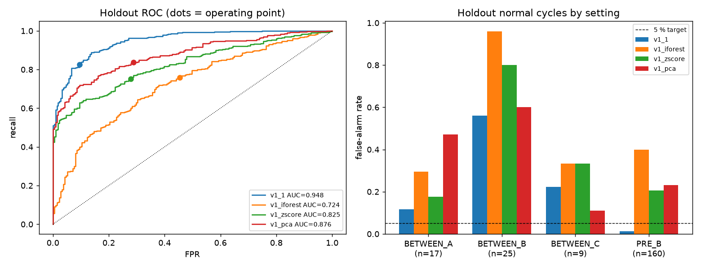

# Robot cycle anomaly detection (voraus-AD)

Offline anomaly detection for a six-axis pick-and-place robot. After a cycle
finishes, the system scores the whole cycle from its motor currents, joint
velocities and torque signals, compares the score with a calibrated threshold,
and points to the channels worth inspecting. Models learn **normal operation
only**; anomalies are used for evaluation, never for training.

**Status: v1.1.** The served model is a Mahalanobis + Local Outlier Factor
ensemble on a multi-condition normal reference, with two alert levels
(warning / alarm). It was chosen in six logged search rounds on a validation
split and scored **once** on a frozen holdout. v1 (pre-registered Isolation
Forest) failed its own criterion; that result is kept unchanged.
Details: [v1.1 report](docs/technical_report_v1_1.md) · [v1 report](docs/technical_report.md) ·
[v1.1 protocol](docs/validation_protocol_v1_1.md) · [changelog](CHANGELOG.md).

## Results at a glance — v1.1 holdout (580 cycles, 369 anomalous, exploratory*)

| Model | Recall | False-alarm rate | Precision | ROC-AUC | AP |
|---|---|---|---|---|---|
| **v1.1 Mahalanobis + LOF — warning level** | **0.827** | **0.095** | **0.938** | **0.948** | **0.970** |
| v1.1 — alarm level | 0.705 | 0.043 | 0.967 | | |
| v1 Isolation Forest (v1 primary) | 0.759 | 0.455 | 0.745 | 0.724 | 0.823 |
| v1 max \|z\| baseline | 0.751 | 0.280 | 0.824 | 0.825 | 0.910 |
| v1 PCA reconstruction | 0.837 | 0.289 | 0.835 | 0.876 | 0.936 |

95 % bootstrap intervals for v1.1: recall 0.786–0.862, false-alarm rate
0.057–0.137, AUC 0.930–0.963. The paired differences against every v1 model
exclude zero for false-alarm rate and AUC.

\*The holdout is half of the official test part, whose aggregate v1 metrics
had already been seen; it was never used for model choice, but it is not an
independent confirmation either. Normal cycles of setting BETWEEN_B still
raise warnings in 56 % of cases (14/25): operating-condition drift is reduced,
not solved.



<details><summary>v1 result (frozen test set: 1174 cycles) — not passed</summary>

| Model (18 channels) | Recall | False-alarm rate | ROC-AUC | AP |
|---|---|---|---|---|
| max \|z\| baseline | 0.743 | 0.253 | 0.829 | 0.911 |
| PCA reconstruction | 0.824 | 0.272 | 0.877 | 0.939 |
| Isolation Forest (primary, pre-specified) | 0.760 | 0.425 | 0.744 | 0.841 |

</details>

## How it works

```text
Parquet (100 Hz) ──► one cycle (T×18) ──► 108 statistics ──► detector ──► score > τ ? ──► CLI / API / replay page
                         audit            mean std min max     fitted on     τ from separate
                                          RMS q95|x|           normal only   normal cycles
```

| Role | Cycles | Purpose |
|---|---|---|
| fit_normal | 570 | fit scalers / PCA / Isolation Forest |
| dev_normal | 188 | stability checks |
| cal_normal | 190 | threshold only |
| test (official) | 1174 | one evaluation after freezing ([protocol](docs/validation_protocol.md)) |

v1.1 adds roles inside the old test part: `val_normal_fit` / `val_normal_cal`
(normal cycles from other settings, for the reference and the threshold),
`val_anomaly` (model choice) and `holdout` (scored once).

Order of commits is the evidence that test data did not leak into choices:
v1 `cef9b9a` freeze → `5cfbc83` test; v1.1 `0f0956b` protocol → `acc5fc7`
selection frozen → `6c266ef` holdout.

## Repository layout

```text
configs/v1.json          channels, features, split, models, threshold, input contract
configs/v1_1*.json       v1.1 protocol settings and the frozen selection
src/robot_ad/            features, detectors, scorer, sequence autoencoder, schema validation, bundle, Predictor, CLI
scripts/01–08            audit → split → features → train/calibrate → evaluate → errors → examples → consistency
scripts/09–12            v1.1 split → validation search (logged) → finalize → single holdout run
api/main.py              FastAPI: GET /health, POST /predict
app/replay.py            Streamlit replay page
tests/                   39 unit tests on synthetic data (no dataset needed)
docs/                    definition, data dictionary, protocol, technical report, demo script, acceptance
reports/                 audit, split manifest, training/evaluation JSON, figures, software evidence
```

## Reproduce

Requires Python 3.12. The dataset (≈1.1 GB, CC BY-NC-SA 4.0) is not in this
repository; download the **100 Hz** Parquet from the official
[voraus-AD repository](https://github.com/vorausrobotik/voraus-ad-dataset) to
`data/raw/voraus-ad-dataset-100hz.parquet`.

```bash
python -m venv .venv
```

```bash
.venv/Scripts/python -m pip install -r requirements.txt -e .
```

Use `.venv/bin/python` on Linux/macOS. Then run the pipeline in order:

```bash
python scripts/01_audit.py
```

```bash
python scripts/02_make_split.py
```

```bash
python scripts/03_extract_features.py
```

```bash
python scripts/04_train_calibrate.py
```

```bash
python scripts/05_evaluate.py
```

```bash
python scripts/06_error_analysis.py
```

```bash
python scripts/07_export_examples.py
```

```bash
python scripts/08_consistency_check.py
```

```bash
python scripts/09_v11_split.py
```

```bash
python scripts/10_v11_search.py --round 1
```

Rounds 1–6 are defined in the script; round 4 was superseded by round 6
(see `reports/v1_1/search_log.jsonl`).

```bash
python scripts/11_v11_finalize.py
```

```bash
python scripts/12_v11_holdout.py
```

`12_v11_holdout.py` refuses to run on a dirty tree, before the selection is
committed, or a second time.

```bash
python -m pytest
```

Each step reads only the outputs of earlier steps; the raw file is never modified.

## Use

CLI (exit code 2 on invalid input):

```bash
python -m robot_ad.cli predict --input data/examples/test_normal_1963.json
```

API:

```bash
uvicorn api.main:app --port 8000
```

```bash
curl -X POST http://127.0.0.1:8000/predict -H "content-type: application/json" --data @data/examples/test_normal_1963.json
```

Replay page:

```bash
streamlit run app/replay.py
```

Request (`robot-cycle-v1`): `schema_version`, `time_s` (T values, seconds,
strictly increasing) and `signals` with exactly the 18 channels
`motor_iq_1..6`, `joint_velocity_1..6`, `torque_sensor_a_1..6`, each of
length T (900–1300), JSON numbers only. Response: `is_anomaly`, `alert_level`
(`normal` / `warning` / `alarm`), `anomaly_score`, `threshold`, `alert_levels`,
`model_version`, `schema_version`, plus `reference_deviations` — the channels
whose statistics deviate most from normal training cycles (an inspection
hint, not an explanation of the model).

## Docker

```bash
docker build -t robot-ad-api:1.1.0 .
```

```bash
docker run --rm -p 8000:8000 robot-ad-api:1.1.0
```

The image serves `models/v1_1__selected.joblib`, never retrains and needs no PyTorch. Set `ROBOT_AD_BUNDLE` to serve another bundle (e.g. v1). **Not yet built
on the development machine** (no Docker installed); see
[reports/docker_status.md](reports/docker_status.md).

## Scope and limitations
Offline, whole-cycle detection on one robot cell. No real-time warning, no
localisation of the anomaly in time, no root-cause diagnosis. A score is not a
fault probability. Results are limited to the tested voraus-AD settings.

## Data and licences
- Data: voraus-AD dataset, Brockmann et al., *The voraus-AD Dataset for
  Anomaly Detection in Robot Applications*, released under CC BY-NC-SA 4.0
  by voraus robotik. Not redistributed here; derived artefacts in `reports/`
  (cycle ids, labels, aggregate statistics, figures) are shared under the same
  licence for non-commercial use.
- Category and setting names follow the official loader `voraus_ad.py` (MIT).
- Code in this repository: MIT ([LICENSE](LICENSE)).
