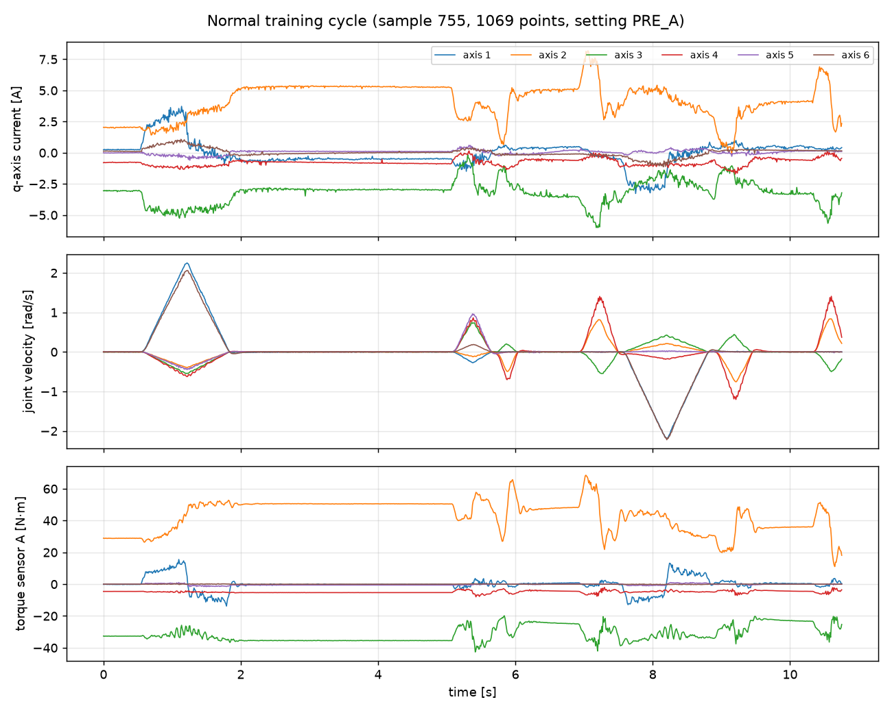
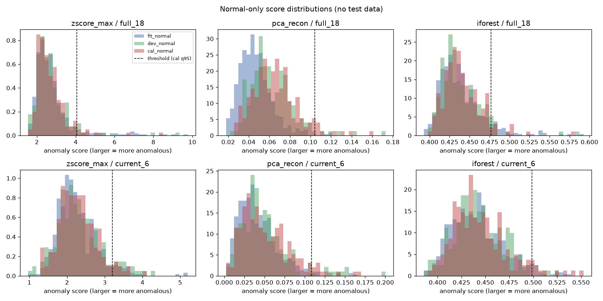
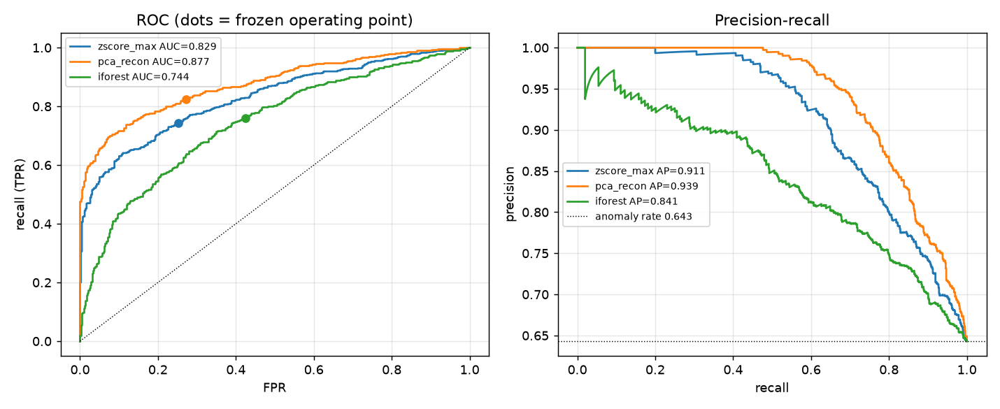
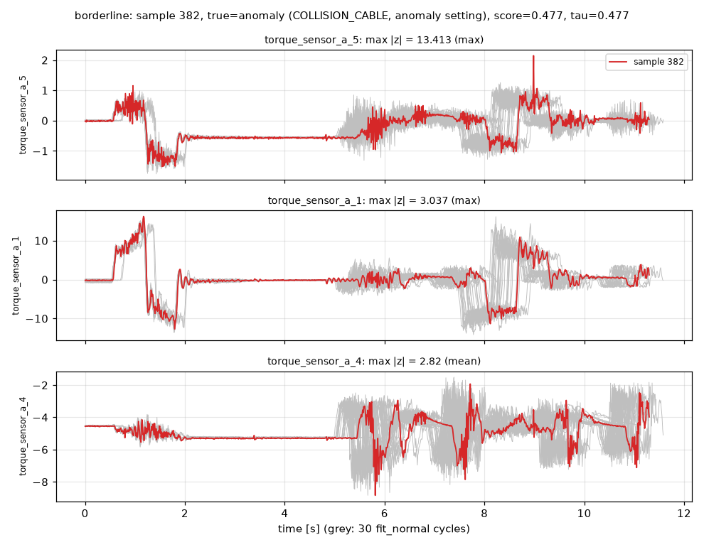
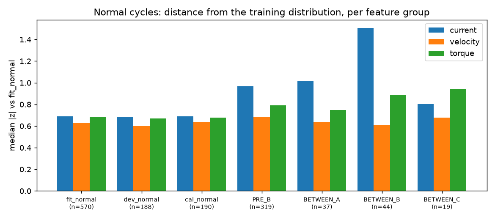

# Technical report — robot cycle anomaly detection v1

*voraus-AD 100 Hz · normal-only training · frozen protocol · evaluated 2026-11-10*

## 1. Summary
A cycle-level anomaly detector was built for a six-axis pick-and-place robot.
Each completed cycle is reduced to 108 statistics of 18 signals (motor
currents, joint velocities, torque sensors); three detectors are fitted on
normal cycles only and a threshold is calibrated on separate normal cycles.

**Main findings on the frozen test set (1174 cycles, 64.3 % anomalous):**

- The **pre-specified primary model, Isolation Forest, did not improve on the
  simple max-|z| baseline**: similar recall (0.760 vs 0.743), much higher false
  alarm rate (0.425 vs 0.253), lower AUC (0.744 vs 0.829). Under the protocol
  the model-effectiveness criterion is **not passed**.
- PCA reconstruction error ranked cycles best (AUC 0.877, AP 0.939). Because
  this was only visible after testing, it is **not** promoted to the served
  model in v1; it is a candidate for a v1.1 that needs fresh validation.
- All detectors raise far more alarms on test normal cycles (20–54 %) than the
  5 % calibration target. The excess comes from **normal operating-condition
  drift between recording settings**, concentrated in the motor currents;
  setting BETWEEN_B is flagged in 66–98 % of its normal cycles.
- Using only the 6 motor currents (ablation) was worse than 18 channels for
  every model in AUC.
- The software path is complete and consistent: batch script, reloaded
  bundle, CLI and API give identical scores (max difference 5.6e-17), and all
  7 malformed-input cases are rejected with explicit error codes.

## 2. Data
voraus-AD, 100 Hz Parquet (2 321 690 rows, 137 columns, SHA-256 `c90ab1c7…f704`).
2122 cycles; labels constant inside every cycle. The official split
(training = setting PRE_A) reproduces the paper exactly: 948 normal training
cycles; 419 normal + 755 anomalous test cycles in 12 categories. Test normal
cycles come from four other settings (PRE_B 319, BETWEEN_A 37, BETWEEN_B 44,
BETWEEN_C 19). Cycles have 986–1164 points at ~10.07 ms; no missing values,
duplicates or non-increasing time stamps were found
([audit_summary.json](../reports/audit_summary.json), [data dictionary](data_dictionary.md)).

## 3. Method
**Sample and features.** One cycle → one row. For each of the 18 channels:
mean, std (ddof 0), min, max, RMS, 95 % quantile of |x|. No padding or
truncation; cycle length is not a feature. Extraction costs 0.21 ms/cycle.

**Roles.** The 948 PRE_A normal cycles were split in blocks of 10
consecutive ids (seed 20261010) into fit 570 / dev 188 / cal 190. The test
part was not read until the protocol was committed (commit `cef9b9a`).

**Detectors** (fitted on `fit_normal`; larger score = more anomalous):
max |z| over features; PCA (95 % variance → 50 components for 18 ch) mean
squared reconstruction error; Isolation Forest (300 trees, seed 42,
`-score_samples`). Each configuration's threshold is the 95 % quantile of its
own `cal_normal` scores; alarm iff score > threshold.

**Pre-test checks.** Dev alarm rates at the calibrated thresholds were
2.7–8.5 %. Isolation Forest with five other seeds gave dev-score Spearman
≥ 0.93 but dev alarm rates 1.1–6.4 %: with 190 calibration cycles the 95 %
quantile rests on ~10 cycles and is noisy.

## 4. Results (frozen thresholds, test set)
AP reference (random ranking) = anomaly rate 0.643; random AUC ≈ 0.5.

| Model | Channels | Recall | FPR | Precision | F1 | ROC-AUC | AP | TP / FN / FP / TN |
|---|---|---|---|---|---|---|---|---|
| zscore_max | 18 | 0.743 | 0.253 | 0.841 | 0.789 | 0.829 | 0.911 | 561 / 194 / 106 / 313 |
| pca_recon | 18 | **0.824** | 0.272 | 0.845 | **0.834** | **0.877** | **0.939** | 622 / 133 / 114 / 305 |
| **iforest (primary)** | 18 | 0.760 | 0.425 | 0.763 | 0.762 | 0.744 | 0.841 | 574 / 181 / 178 / 241 |
| zscore_max | 6 currents | 0.726 | 0.399 | 0.766 | 0.746 | 0.736 | 0.845 | 548 / 207 / 167 / 252 |
| pca_recon | 6 currents | 0.376 | 0.098 | 0.874 | 0.526 | 0.702 | 0.828 | 284 / 471 / 41 / 378 |
| iforest | 6 currents | 0.760 | 0.537 | 0.718 | 0.739 | 0.690 | 0.812 | 574 / 181 / 225 / 194 |

**Per anomaly category** (18 channels; TP and recall at the frozen threshold):

| Category | n | zscore_max | pca_recon | iforest |
|---|---|---|---|---|
| AXIS_FRICTION | 144 | 114 (0.79) | 138 (0.96) | 126 (0.88) |
| AXIS_WEIGHT | 156 | 130 (0.83) | 113 (0.72) | 150 (0.96) |
| CAN_WEIGHT | 80 | 56 (0.70) | 68 (0.85) | 41 (0.51) |
| COLLISION_CABLE | 48 | 19 (0.40) | 32 (0.67) | 19 (0.40) |
| COLLISION_CARTON | 22 | 10 (0.45) | 11 (0.50) | 13 (0.59) |
| COLLISION_FOAM | 72 | 50 (0.69) | 53 (0.74) | 53 (0.74) |
| ENTANGLED | 10 | 10 (1.00) | 10 (1.00) | 10 (1.00) |
| INVALID_POSITION | 12 | 2 (0.17) | 12 (1.00) | 8 (0.67) |
| LOSE_CAN | 74 | 47 (0.64) | 65 (0.88) | 27 (0.36) |
| MISS_CAN | 11 | 11 (1.00) | 11 (1.00) | 11 (1.00) |
| MOTOR_COMMUTATION | 89 | 89 (1.00) | 89 (1.00) | 89 (1.00) |
| WOBBLING_STATION | 37 | 23 (0.62) | 20 (0.54) | 27 (0.73) |

**False alarms per test normal setting** (FP and FPR; calibration target 0.05):

| Setting | n | zscore_max | pca_recon | iforest |
|---|---|---|---|---|
| PRE_B | 319 | 63 (0.20) | 70 (0.22) | 120 (0.38) |
| BETWEEN_A | 37 | 4 (0.11) | 14 (0.38) | 11 (0.30) |
| BETWEEN_B | 44 | 36 (0.82) | 29 (0.66) | 43 (0.98) |
| BETWEEN_C | 19 | 3 (0.16) | 1 (0.05) | 4 (0.21) |

Categories with 10–22 cycles (ENTANGLED, MISS_CAN, INVALID_POSITION,
COLLISION_CARTON) give very wide uncertainty on their recall.

## 5. Error analysis (primary model)
Eight cases were inspected ([error_analysis.json](../reports/error_analysis.json),
`reports/figures/case_*.png`).

| Case | Sample | Truth | Score / τ = 0.477 | Observation |
|---|---|---|---|---|
| False alarm | 1840 | normal, PRE_B | 0.585 | Joint velocities 2–4 have \|z\| ≈ 8 — the motion itself differs from PRE_A (cause not identified; possibly a different pick position or speed); all three detectors alarm. |
| False alarm | 2066 | normal, BETWEEN_B | 0.562 | Current axis 1 and torque axis 4 shifted; typical of the BETWEEN_B drift below. |
| False alarm | 1962 | normal, PRE_B | 0.553 | Velocity and current shifts of axes 3–4; all detectors alarm. |
| Missed | 412 | COLLISION_CABLE | 0.421 | Max \|z\| only 2.0: a soft cable contact hardly changes cycle statistics; missed by all detectors. |
| Missed | 409 | COLLISION_CABLE | 0.425 | Same pattern, max \|z\| 2.8; missed by all. |
| Missed | 574 | CAN_WEIGHT | 0.426 | Torque axis 5 \|z\| = 6.5 is caught by z-score and PCA but not by Isolation Forest. |
| Borderline | 382 | COLLISION_CABLE | 0.477 (= τ) | A short torque-5 spike at ~9 s gives \|z\| = 13.4 on one feature; Isolation Forest barely reacts. |
| Borderline | 2018 | normal, PRE_B | 0.477 | Moderate shifts (\|z\| ≤ 3); PCA alarms, z-score does not. |

**Why Isolation Forest underperforms here (interpretation).** Its random
splits choose one of 108 features at a time, so a strong deviation confined to
one or two features (cases 382, 574) changes the path length only a little,
while broad, mild shifts of many correlated features — exactly what normal
drift between settings produces — shorten paths everywhere. The max-|z| score
reacts to the single extreme feature, and PCA measures departure from the
correlation structure of normal cycles, which fits these failure modes
better. This explanation is consistent with the cases above but has not been
tested in isolation.

**Normal drift.** Relative to `fit_normal`, the median |z| of the current
features rises from 0.69 (fit/dev/cal) to 0.97 (PRE_B), 1.02 (BETWEEN_A) and
1.51 (BETWEEN_B); velocity features stay at 0.61–0.69, i.e. the commanded
motion is largely unchanged while the electrical load differs. For BETWEEN_B
the most shifted features are torque axis 4 (mean, RMS) and the spread of
motor currents 1, 4 and 6 (mean z ≈ 3–4). Possible causes include thermal
state, friction or payload changes between recording sessions (待核实 — the
dataset documentation would have to confirm what differs between settings).

**Limits of cycle statistics.** Short events (a brief contact, a dropped can
late in the cycle) are diluted by whole-cycle mean/std/RMS; only min/max/q95
can retain them. Phase information (which motion segment deviated) is lost.

## 6. Software
- Model bundle: detector + feature spec + column order + fitted deviation
  statistics + threshold + split/config/data fingerprints + Git commit +
  dependency versions (`models/*.joblib` + readable `.json`).
- `robot_ad.predict.Predictor` is the only scoring path; the CLI, FastAPI
  (`GET /health`, `POST /predict`) and the Streamlit replay page all call it.
- Input contract `robot-cycle-v1`: exactly the 18 channels, equal lengths,
  finite values, strictly increasing time, 900–1300 points, step 5–20 ms.
- Evidence: [consistency.json](../reports/consistency.json) (24 examples ×
  4 paths, max |Δscore| 5.6e-17; 7/7 invalid cases rejected with the expected
  code), [api_run_evidence.json](../reports/api_run_evidence.json) (live
  uvicorn: startup 1.7 s, one prediction ≈ 12 ms server-side; logs carry
  version, score and timing but no raw arrays), 24 unit tests.
- Docker: `Dockerfile` written; image **not built on the development machine**
  because Docker is not installed ([docker_status.md](../reports/docker_status.md)).

## 7. Limitations
- Single robot and task; conclusions do not transfer to other cells.
- Test normal data come from different settings than training; the 5 %
  calibration target does not hold there (measured 20–54 %).
- The threshold is estimated from 190 cycles; its alarm rate is uncertain by
  several percentage points.
- The reference deviation hint is a per-channel z-score, not an explanation
  of the Isolation Forest decision.
- Several categories have ≤ 22 test cycles.

## 8. Next version (v1.1+, results will be exploratory because the test set has been seen)
1. Recalibrate or adapt to operating-condition drift (e.g. per-setting
   normal reference, a small set of recent normal cycles), and measure FPR on
   a held-out normal setting rather than PRE_A only.
2. Promote PCA or a max-|z|/PCA combination, with the decision made on a
   split that excludes the current test set (e.g. leave-one-normal-setting-out).
3. Add phase-aware features (per `action` segment) or a 1D-CNN autoencoder to
   capture short events — the planned optional PyTorch extension.
