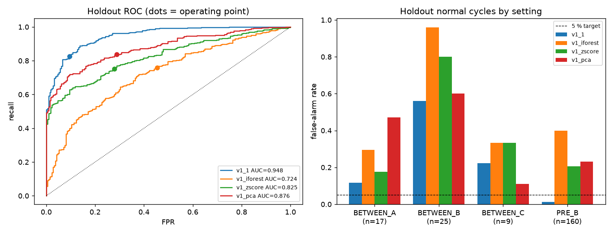
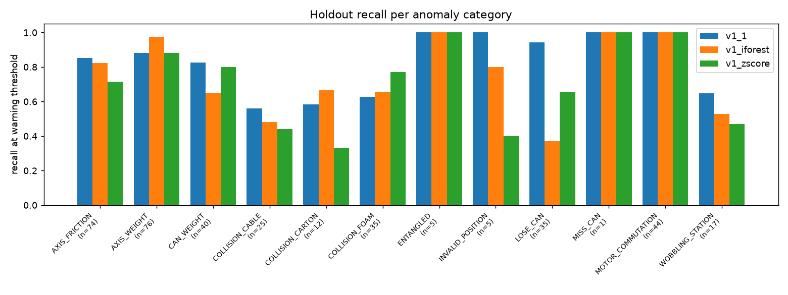

# Technical report — v1.1: validation search and holdout (2026-11-10)

> **Exploratory.** The holdout is half of the v1 test part, and v1's aggregate
> metrics on that part had already been seen. The holdout was never used for
> any v1.1 choice and was scored once, but it is not an independent confirmation.
> The v1 report ([technical_report.md](technical_report.md)) is unchanged.

## 1. What changed and why
v1 failed because normal cycles from other recording settings looked
anomalous (v1 report §5). A deployed monitor would collect normal cycles from
each operating condition during commissioning. So v1.1 (i) adds normal cycles
from the other settings to the normal reference and to the calibration pool,
and (ii) searches a wider range of detectors, on validation data only. The
[protocol](validation_protocol_v1_1.md) was registered in commit `0f0956b`,
before any v1.1 model was fitted.

Split of the old test part (blocks of 5 consecutive ids, stratified by
setting / category): val_normal_fit 103 · val_normal_cal 105 · val_anomaly 386 ·
**holdout 580** (211 normal: PRE_B 160, BETWEEN_A 17, BETWEEN_B 25,
BETWEEN_C 9; 369 anomalous).

## 2. Search (validation only, `reports/v1_1/search_log.jsonl`)
Criterion: mean TPR at 5 % FPR over 5 block-level re-splits of the validation
normals; tie-break: mean AUC. 68 candidates in 6 rounds, all logged.

| Round | Content | Best (TPR@5 % ± sd, AUC) |
|---|---|---|
| 1 | 8 families × {PRE_A-only, multi-condition reference} | Mahalanobis, multi: 0.814 ± 0.023, 0.963 |
| 2 | hyper-parameters (PCA variance, k, LOF n, OCSVM ν, IF max_features) | LOF n=10: 0.813 ± 0.018, 0.965 |
| 3 | 1D-CNN autoencoder on resampled raw cycles (PyTorch) | mean-error score 0.680; peak score 0.27 |
| 4 | combinations — **superseded** (normalization bug, see below) | — |
| 5 | autoencoder seeds / width / training length | width 32, 160 epochs: 0.719 ± 0.037 |
| 6 | combinations, rerun after the fix | **Mahalanobis + LOF(10): 0.829 ± 0.017, 0.968** |

Findings:
- A multi-condition normal reference helps almost every detector
  (Mahalanobis 0.740 → 0.814, kNN 0.628 → 0.751, LOF 0.608 → 0.758).
  Isolation Forest stays weakest (≈ 0.49) whatever its settings.
- The selected ensemble leads Mahalanobis alone by less than one standard
  deviation. The pre-registered rule chose it, not a meaningful margin.
- The sequence autoencoder did not beat the feature models. Its "peak"
  score failed (0.27): resampling to normalized time misaligns motion phases
  between cycles, so normal cycles also produce local error peaks. Phase
  alignment (e.g. per `action` segment) is needed before a sequence model can
  exploit short events.
- Two bugs were found and fixed during the search, both recorded:
  (1) Python's salted `hash()` silently disabled the cross-round cache;
  (2) combination normalization used in-sample kNN/LOF scores (kNN
  self-distance = 0), which made every kNN combination equal to kNN alone.
  Round 4 is marked superseded and was rerun as round 6 with leave-one-out
  training scores.
- GPU: on the RTX 4060 (torch 2.11+cu128, driver 596.36) training crashed
  intermittently with an illegal memory access on the second run in a
  process. With cuDNN disabled it was stable but slower than CPU (33 s vs 26 s
  per fit), so the autoencoder trains on CPU.

## 3. Final model (`configs/v1_1_selected.json`, commit `acc5fc7`)
Mahalanobis distance (Ledoit-Wolf covariance) + Local Outlier Factor
(n = 10), each on the standardized 108 features, normalized by its normal
training scores and averaged. Reference: fit_normal + val_normal_fit (673
cycles). Calibration pool: cal_normal + val_normal_cal (295 cycles).
**Warning** = 95 % quantile (1.382); **alarm** = 99 % quantile (1.917).

## 4. Holdout results (scored once, commit `6c266ef`)
| Model | Recall | FPR | Precision | F1 | AUC | AP | TP / FN / FP / TN |
|---|---|---|---|---|---|---|---|
| **v1.1 warning** | **0.827** | **0.095** | 0.938 | **0.879** | **0.948** | **0.970** | 305 / 64 / 20 / 191 |
| v1.1 alarm | 0.705 | 0.043 | 0.967 | 0.815 | | | 260 / 109 / 9 / 202 |
| v1 Isolation Forest | 0.759 | 0.455 | 0.745 | 0.752 | 0.724 | 0.823 | 280 / 89 / 96 / 115 |
| v1 z-score | 0.751 | 0.280 | 0.824 | 0.786 | 0.825 | 0.910 | 277 / 92 / 59 / 152 |
| v1 PCA | 0.837 | 0.289 | 0.835 | 0.836 | 0.876 | 0.936 | 309 / 60 / 61 / 150 |

AP reference = anomaly rate 0.636. 95 % stratified bootstrap (2000 resamples):
v1.1 recall 0.786–0.862, FPR 0.057–0.137, AUC 0.930–0.963.
Paired differences v1.1 − v1 model:

| vs | Recall | FPR | AUC |
|---|---|---|---|
| Isolation Forest | +0.02 … +0.12 | −0.43 … −0.29 | +0.19 … +0.26 |
| z-score | +0.04 … +0.12 | −0.24 … −0.13 | +0.10 … +0.15 |
| PCA | −0.05 … +0.02 (no difference) | −0.26 … −0.13 | +0.05 … +0.10 |

**False alarms per normal setting** (warning level; alarm level in brackets):
PRE_B 2/160 = 1 % (1 %) · BETWEEN_A 2/17 = 12 % (0 %) · **BETWEEN_B 14/25 = 56 % (32 %)** ·
BETWEEN_C 2/9 = 22 % (0 %). The overall 9.5 % is driven by BETWEEN_B.

**Recall per category** (warning level, n in brackets): MOTOR_COMMUTATION
1.00 (44) · LOSE_CAN 0.94 (35; v1 IF 0.37) · AXIS_WEIGHT 0.88 (76) ·
AXIS_FRICTION 0.85 (74) · CAN_WEIGHT 0.82 (40) · WOBBLING_STATION 0.65 (17) ·
COLLISION_FOAM 0.63 (35) · COLLISION_CARTON 0.58 (12) · COLLISION_CABLE 0.56 (25) ·
ENTANGLED, INVALID_POSITION, MISS_CAN 1.00 with n ≤ 5. Collisions remain the
weak spot: the short-event limitation of cycle statistics is not removed.

## 5. Software
v1.1 is served by default (API, CLI, replay page, Docker). Responses add
`alert_level` and `alert_levels`. Consistency across batch / reload / CLI / API:
max |Δscore| 9.4e-13 on 24 examples; 7/7 invalid inputs rejected
([consistency.json](../reports/consistency.json)). The LOF search has a
one-off initialization cost (~1.4 s), now paid by a warm-up at API start; a
prediction then takes about 11–12 ms server-side
([api_run_evidence.json](../reports/api_run_evidence.json)). The API was run
in a clean environment holding only `requirements-api.txt` (no pandas,
PyTorch or matplotlib); the Docker build itself has still not been run.

## 6. Limits
- Holdout normals come from the same settings as the reference. A new,
  unseen operating condition would need its own commissioning cycles; that
  case is not measured.
- BETWEEN_B normal cycles still raise warnings 56 % of the time; a
  per-condition reference or adaptive recalibration is the next step.
- Anomaly variants appear on both sides of the split, so generalisation to
  new fault variants is not measured.
- MISS_CAN, ENTANGLED and INVALID_POSITION have ≤ 5 holdout cycles.
